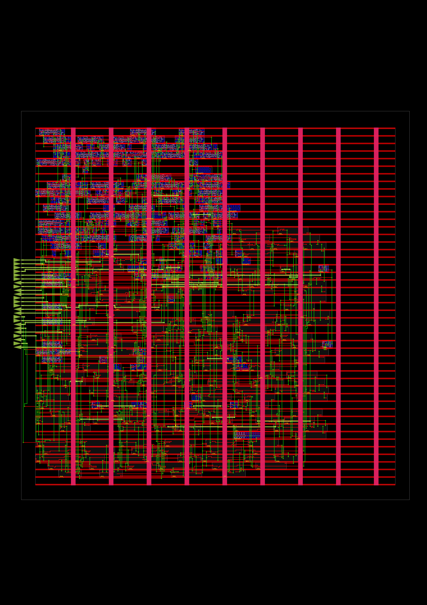

# Asynchronous FIFO: RTL to GDS (SkyWater sky130 HD)

A 16-entry x 8-bit asynchronous (dual-clock) FIFO, taken through the full open-source digital flow: RTL, logic synthesis, gate-level simulation, place & route, and layout export.



## Design

| Item | Value |
|---|---|
| Data width / depth | 8 bits / 16 entries (`DATA_W=8`, `ADDR_W=4`) |
| Write clock | 100 MHz (`wclk`, 10 ns) |
| Read clock | ~71.43 MHz (`rclk`, 14 ns) |
| Pointers | binary pointers for addressing, Gray-coded pointers for crossing clock domains |
| Synchronizers | 2-FF synchronizer per pointer bit (`sync_2ff`) |
| Resets | asynchronous assert, synchronous release, one synchronizer per domain (`reset_sync`) |
| Full / empty | `wfull` computed in the write domain, `rempty` in the read domain, from the synchronized opposite Gray pointer |

### Modules

- `async_fifo.v`: top level
- `wptr_full.v`: write pointer and full flag
- `rptr_empty.v`: read pointer and empty flag
- `sync_2ff.v`: 2-FF pointer synchronizer
- `reset_sync.v`: reset synchronizer
- `dp_ram.v`: dual-port memory (write on `wclk`, registered read on `rclk`)

## Flow

| Step | Tool |
|---|---|
| RTL simulation | Icarus Verilog |
| Logic synthesis | Yosys, mapped to `sky130_fd_sc_hd` |
| Gate-level simulation | Icarus Verilog with behavioural cell models (`cells_sim.v`) |
| Floorplan, placement, CTS, routing, STA | OpenROAD |
| Layout export / viewing | KLayout (Python API, `klayout` package) |

## Verification

The testbench (`async_fifo_tb.v`) runs with unrelated clocks (10 ns and 14 ns) and random write/read activity in three stages:

1. Write only, until the FIFO is full (checks exactly 16 writes are accepted and `wfull` asserts).
2. Faster reader, FIFO drains (checks `rempty` is observed).
3. Faster writer, FIFO fills again, then drains (checks `wfull` is observed and the FIFO ends empty).

All 300 words are checked in order against the expected data pattern. Garbage is driven on `wdata` when not writing, to check the write enable gates the RAM.

| Simulation | Result |
|---|---|
| RTL | ALL PASSED (300 items) |
| Gate-level (post-synthesis netlist) | ALL PASSED (300 items) |

Both runs report identical stage results (16 accepted writes at full, 120 reads after stage 2, 300 reads at the end).

## Physical design results (OpenROAD, sky130hd, tt 25C 1.8V)

| Metric | Value |
|---|---|
| Design area | 7059 um^2 (43% utilization, 40% target) |
| Total wire length | 11821 um |
| Vias | 2996 |
| Detailed routing violations | 0 |
| Worst setup slack (`wclk`, `winc` to RAM write enable) | +6.65 ns |
| Worst setup slack (`rclk`) | +10.85 ns |
| Worst async reset recovery slack | +9.48 ns |
| Worst hold slack | +0.36 ns (`rclk`), +0.36 ns (`wclk`) |
| Worst async reset removal slack | +0.38 ns |
| Clock skew (setup) | about 0.01 ns on each clock |

## Limitations and notes

- Timing is reported after detailed routing, with parasitics estimated from the global route (`estimate_parasitics -global_routing`), not extracted from the final routed layout.
- `wclk` and `rclk` are declared asynchronous with `set_clock_groups -asynchronous`, so paths between the two domains are not timed by STA. Clock-domain-crossing safety relies on the architecture (Gray-coded pointers plus 2-FF synchronizers) and on simulation, not on a static CDC check.
- The memory has no SRAM macro; Yosys maps it to standard-cell flip-flops, which is why the area is dominated by storage.
- The exported GDS is built from the routed DEF using the LEF abstracts of the standard cells (cell outlines, pins, routing). It does not contain transistor-level cell geometry, and layer numbers follow KLayout defaults rather than the sky130 GDS layer map.

## How to reproduce

```
make sim      # RTL + gate-level simulation
make synth    # Yosys
make pnr      # OpenROAD
make gds      # GDS export
make all      # everything
```

The synthesis script (`synth_fifo.ys`) runs:

```
read_verilog async_fifo.v dp_ram.v reset_sync.v rptr_empty.v sync_2ff.v wptr_full.v
synth -top async_fifo -flatten
dfflibmap -liberty sky130_fd_sc_hd__tt_025C_1v80.lib -dont_use *lpflow*
abc -liberty sky130_fd_sc_hd__tt_025C_1v80.lib -dont_use *lpflow* -dont_use *probe* -dont_use *clkdlybuf*
hilomap -singleton -hicell sky130_fd_sc_hd__conb_1 HI -locell sky130_fd_sc_hd__conb_1 LO
opt_clean -purge
write_verilog -noattr -noexpr async_fifo_sky130.v
stat
```